<p align="center">
  
</p>

<p align="center">
  
  
  
  
  
  <a href="LICENSE"></a>
  <a href="https://github.com/ramalhoboss/ps5-memory-dumper/releases/latest"></a>
</p>

# PS5 Memory Dumper

**PS5 Memory Dumper** reads memory from a **jailbroken PS5** over the local network and saves it to your PC, using
the [ps5debug-NG](https://github.com/Pharaoh2k/ps5debug-NG) payload. It dumps the memory regions of any running
process (games included) and ranges of kernel memory, resumes interrupted dumps, reconnects on its own when the
connection drops, and turns dumps into files that reverse-engineering tools understand: a flat image placed by
address, or an **x86-64 ELF for Ghidra / IDA**. Offline, it compares two dumps and searches values across dumps,
like a memory scanner.

It comes as a **desktop app** (black and gold Qt interface, one self-contained `.exe`) and as a **command line**
with the same engine.

Developed by **RamalhoBoss** · [x.com/nuno_leugim_10](https://x.com/nuno_leugim_10)

> [!WARNING]
> For research and homebrew on **your own console**. It needs a jailbroken PS5 running ps5debug-NG, and it only
> **reads** memory.
>
> **To dump the kernel, the hypervisor must be disabled on the PS5 first** (run the hypervisor bypass after the
> jailbreak, before loading ps5debug-NG). With the hypervisor active, kernel code cannot be read and a kernel read
> can restart the console. This applies to the full kernel and to manual ranges. Process dumps do not need it.
> Read the [kernel notes](#kernel-capture) before dumping the kernel.

## Contents

- [Features](#features) · [Screenshots](#screenshots) · [Getting started](#getting-started)
- [Using the app](#using-the-app) · [Command line](#command-line)
- [How it works](#how-it-works) · [Output format](#output-format) · [Building the .exe](#building-the-exe)
- [Project layout](#project-layout) · [Testing and status](#testing-and-status) · [Original script](#original-script) ·
  [Credits and licences](#credits-and-licences)

## Features

| | |
|---|---|
| 🔌 **Connect** | Finds consoles on the LAN (ps5debug UDP broadcast, port 1010) or connects by IP (TCP 744). Shows payload, firmware and the running game (title ID, version, PID). IP history is remembered. |
| 🎮 **Process dumps** | Lists processes (the running game is tagged), shows each memory region with address, size and permissions, filters by name, writable, executable and size, and dumps the ticked regions with speed, ETA and Cancel. *Dump running app* goes straight to the game's regions. |
| 🧠 **Kernel capture** | **Full kernel image, detected automatically** on firmware 13.60 (start and exact size from the kernel's module record), or a **manual range** of up to 83 MiB on any firmware. 16 KiB requests that never cross a page boundary. Requires the **hypervisor disabled** on the PS5. |
| 🛟 **Unreadable memory** | 1 MiB blocks; a refused block is split down to 4 KiB pages so every readable byte is kept. Unreadable pages become zeros, so *file offset = address − region start*, and every gap is recorded. |
| ⏯️ **Resume** | A cancelled, failed or interrupted dump continues where it stopped: complete regions are kept, partial files are continued, and with *retry gaps* unreadable pages are read again and patched in place. Refuses if the process or kernel changed. |
| 🔁 **Auto-reconnect** | When the connection drops during a process dump, it reconnects and repeats the same request (1, 2, 4… s, up to 30 s between tries, 5 tries by default). |
| 📦 **Exports** | **Flat image** of the ticked regions placed by address (holes become zeros). **ELF64 x86-64** with one `PT_LOAD` segment per region at its real address, for Ghidra / IDA. Literal concatenation of `.bin` files. |
| 🔍 **Compare dumps** | Changed byte ranges between two dumps of the same process, per region, with before/after bytes and CSV export. |
| 🎯 **Value search** | First scan in one dump, then *next scans* in later dumps: equals, changed, unchanged, increased, decreased. Types: int8/16/32/64, float, double, string, UTF-16, and byte patterns with `??` wildcards. CSV export. |
| 🧰 **Tools** | Split a large snapshot into data segments by zero runs and restore it exactly, with SHA-256 checks. |
| 🧾 **Manifests** | Every dump writes `manifest.json`: regions, gaps, errors, SHA-256 per file, status, reconnects and resumes. Older dumps (`mapas.json`) are read too. |

## Screenshots

<table>
  <tr>
    <td width="50%">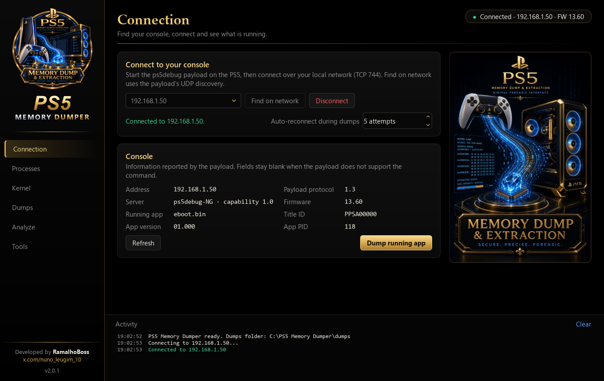<br><sub><b>Connection</b>: discovery, console and running game.</sub></td>
    <td width="50%">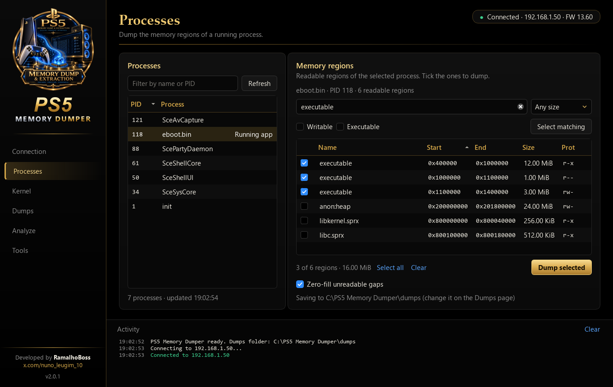<br><sub><b>Processes</b>: regions with filters, ready to dump.</sub></td>
  </tr>
  <tr>
    <td>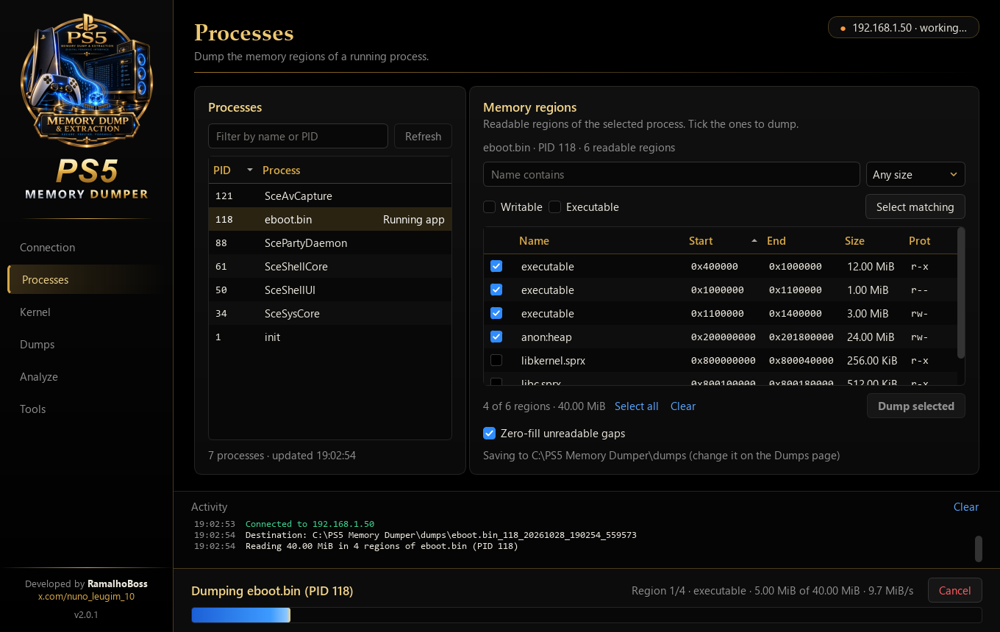<br><sub><b>Dumping</b>: progress, speed, ETA and Cancel.</sub></td>
    <td>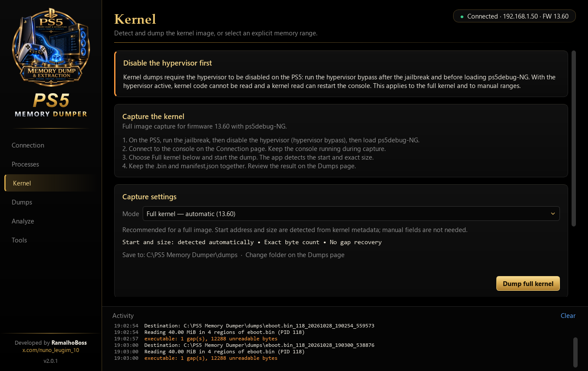<br><sub><b>Kernel</b>: automatic full image (13.60) or manual range; hypervisor disabled first.</sub></td>
  </tr>
  <tr>
    <td>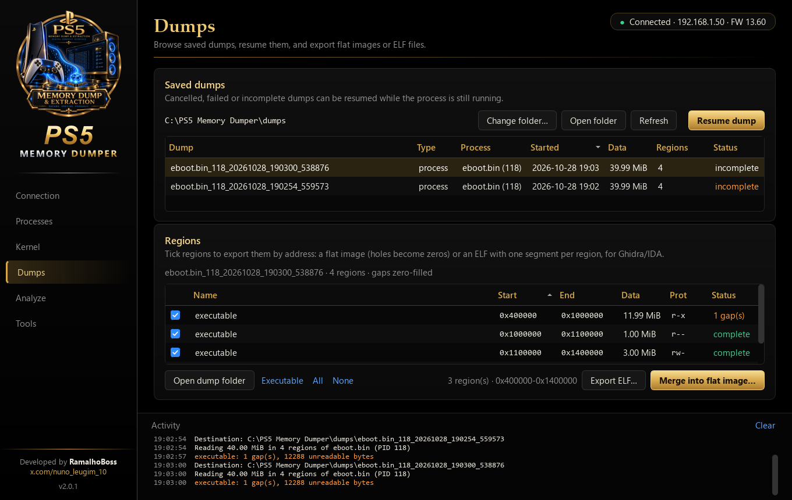<br><sub><b>Dumps</b>: status, resume, flat image and ELF export.</sub></td>
    <td>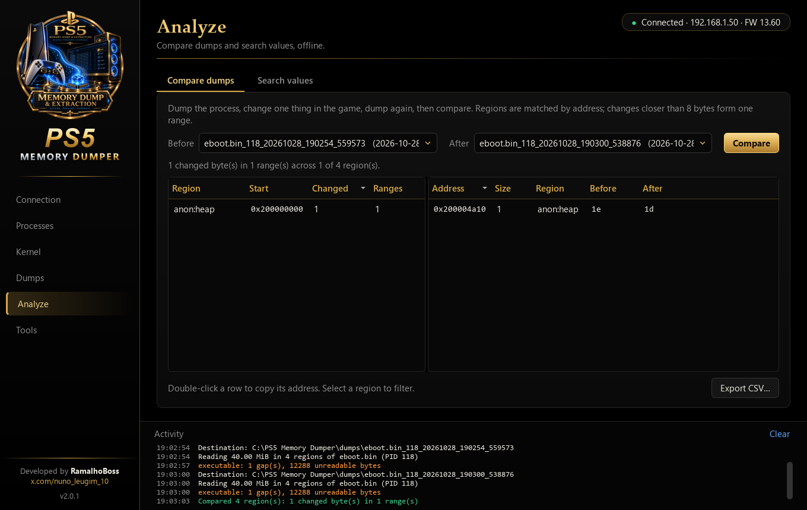<br><sub><b>Analyze → Compare</b>: what changed between two dumps.</sub></td>
  </tr>
  <tr>
    <td>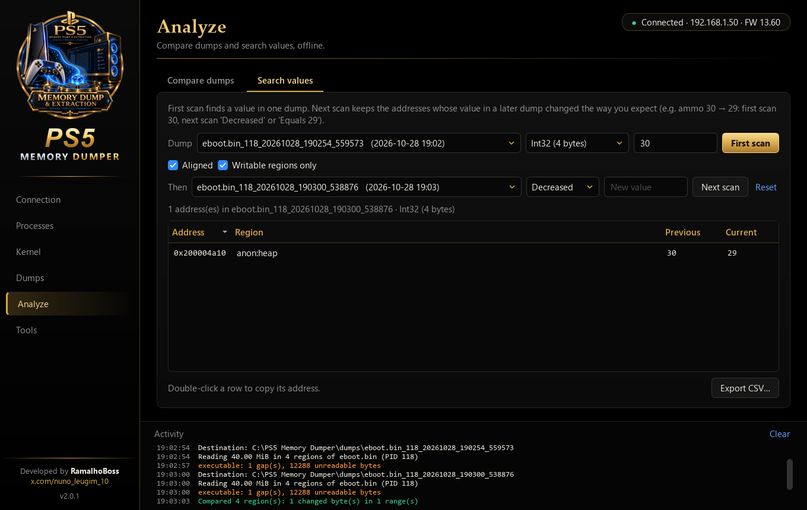<br><sub><b>Analyze → Search</b>: ammo 30 → 29 found with a <i>Decreased</i> scan.</sub></td>
    <td>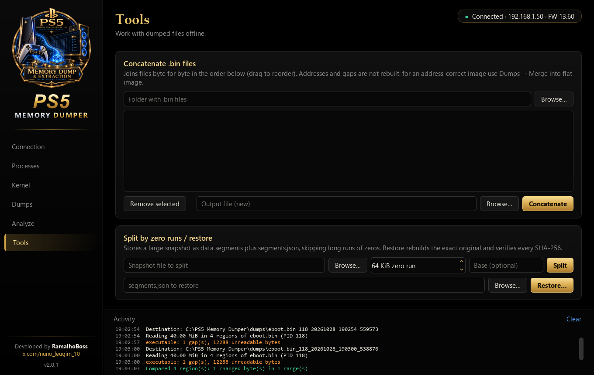<br><sub><b>Tools</b>: concatenate, split by zero runs, restore.</sub></td>
  </tr>
</table>

<sub>Screenshots were taken against a simulated console; addresses and values are illustrative.</sub>

## Getting started

### What you need

- A PS5 with a jailbreak and the **ps5debug-NG** payload running, on the same network as the PC.
- Windows 10 or 11. The firewall must allow the app on the local network (TCP 744 to the console; UDP 1010 for
  *Find on network*).
- For **any kernel dump** (full image or manual range): the **hypervisor disabled** on the PS5, with the hypervisor
  bypass run after the jailbreak and before loading ps5debug-NG. The automatic **full kernel image** also needs
  firmware **13.60**; other firmware versions can use the manual kernel range.

### Option 1: the Windows app

Download **`PS5 Memory Dumper.exe`** (or the `.zip` with the licence files) from the
[latest release](https://github.com/ramalhoboss/ps5-memory-dumper/releases/latest) and run it: it is one
self-contained file, no Python or other files needed. Dumps are saved in a `dumps` folder next to the `.exe`.
Windows SmartScreen may warn about an unsigned app the first time; choose *More info → Run anyway*. You can also
build it yourself (see [Building the .exe](#building-the-exe)).

### Option 2: from source

```bash
python -m pip install -r requirements.txt
python -m ps5dumper                 # desktop app (or double-click "PS5 Memory Dumper.pyw")
python ps5_dumper.py --help         # command line
```

Requirements: `ps5dbg==0.1.1` (the ps5debug-NG client) and `PySide6-Essentials>=6.10`. Developed and tested with
Python 3.14 on Windows 11.

## Using the app

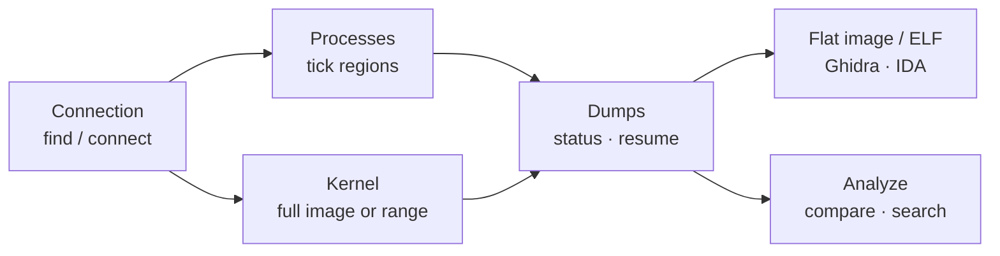

| Page | What you do there |
|------|-------------------|
| **Connection** | *Find on network* or type the PS5 IP, then *Connect*. The card shows the payload, firmware and running game. *Dump running app* opens the game's regions. *Auto-reconnect during dumps* sets how many times a dump reconnects by itself. |
| **Processes** | Pick a process, filter its regions (name, writable, executable, maximum size), *Select matching* or tick them by hand, then *Dump selected*. *Zero-fill unreadable gaps* keeps file offsets equal to address offsets (recommended). |
| **Kernel** | First disable the hypervisor on the PS5: the page warns about it and asks you to confirm before every kernel dump. *Full kernel – automatic (13.60)* detects the start and exact size and reads that many bytes. *Manual range – advanced*: read the `.data` base, enter a start address and a size (up to 83 MiB), optionally with experimental page recovery. |
| **Dumps** | Every dump in the dumps folder, newest first, with its status. *Resume dump* continues an unfinished one. Tick regions (*Executable* ticks the code regions) and choose *Merge into flat image…* or *Export ELF…*. |
| **Analyze** | *Compare dumps*: pick *Before* and *After*. *Search values*: first scan a value in one dump, then keep only the addresses that changed the way you expect in a later dump (for example ammo 30 → 29: first scan 30, next scan *Decreased*). Double-click copies an address; both tabs export CSV. |
| **Tools** | Concatenate `.bin` files byte for byte; split a snapshot by zero runs and restore it with SHA-256 checks. |

Settings (IP history, dumps folder, zero-fill, reconnect attempts, window layout) are remembered between runs.

## Command line

The same engine runs from the terminal. With no arguments `ps5_dumper.py` is interactive (`D` discovers consoles,
`C` opens the concatenation menu).

```bash
# dumps (console needed)
python ps5_dumper.py --discover --pid 118 --prot x               # executable regions of PID 118
python ps5_dumper.py --ip 192.168.1.50 --pid 118 --name heap     # regions whose name contains "heap"
# kernel dumps: disable the hypervisor on the PS5 first
python ps5_dumper.py --ip 192.168.1.50 --kernel                  # full kernel, detected (13.60)
python ps5_dumper.py --ip 192.168.1.50 --kernel --size-mib 8     # explicit range from the .data base
python ps5_dumper.py --ip 192.168.1.50 --resume dumps/eboot.bin_118_20261028_112540_053773
python ps5_dumper.py --ip 192.168.1.50 --resume dumps/... --retry-gaps

# offline (no console)
python ps5_dumper.py --export-elf dumps/some_dump --prot x                         # ELF for Ghidra/IDA
python ps5_dumper.py --concat dumps/some_dump                                       # literal concatenation
python ps5_dumper.py --compare dumps/before dumps/after --report changes.csv
python ps5_dumper.py --search dumps/before --type int32 --value 30 --then dumps/after decreased
python segment_memory.py split big.raw out_dir --base 0x400000                      # split by zero runs
```

<details>
<summary><b>All options</b></summary>

| Option | Meaning |
|--------|---------|
| `--ip IP` / `--discover` | Console address, or find it on the LAN. |
| `--retries N` | Reconnections per request when the connection drops (default 5, `0` = off). |
| `--pid PID` | Process to dump (`0` = kernel, hypervisor must be disabled); skips the interactive menu. |
| `--prot x\|rw\|…` | Only regions that have all these permissions (dumps and `--export-elf`). |
| `--name TEXT` | Only regions whose name contains TEXT, case-insensitive. |
| `--max-region-mib N` | Skip regions larger than N MiB. |
| `--no-fill-gaps` | Old format: only received bytes are written, so offsets drift after a gap. |
| `--kernel` | Kernel capture; **the hypervisor must be disabled on the PS5**. Without `--start`/`--size-mib`: automatic full image (13.60). In interactive mode the app asks you to confirm first. |
| `--start ADDR` / `--size-mib N` | Explicit kernel range (maximum 83 MiB). |
| `--kernel-recover` | **Experimental**: split refused kernel blocks and zero-fill them. A fault in kernel mode restarts the console. |
| `--output FOLDER` | New destination folder; existing folders are never replaced. |
| `--resume FOLDER` / `--retry-gaps` | Continue an unfinished dump; optionally read its gaps again. |
| `--export-elf FOLDER` / `--elf-output FILE` / `--elf-type exec\|core` | ELF export. |
| `--concat FOLDER` / `--concat-output FILE` | Literal concatenation of the `.bin` files. |
| `--compare BEFORE AFTER` | Changed byte ranges between two dumps. |
| `--search FOLDER --type T --value V` | First scan. Types: `int8 int16 int32 int64 float double string utf16 bytes`. |
| `--then FOLDER CONDITION [VALUE]` | Next scan; repeatable. Conditions: `equals changed unchanged increased decreased`. |
| `--unaligned` / `--writable-only` | Search options. |
| `--report FILE` | Write every compare/search result to a new CSV file. |

</details>

## How it works

### Architecture

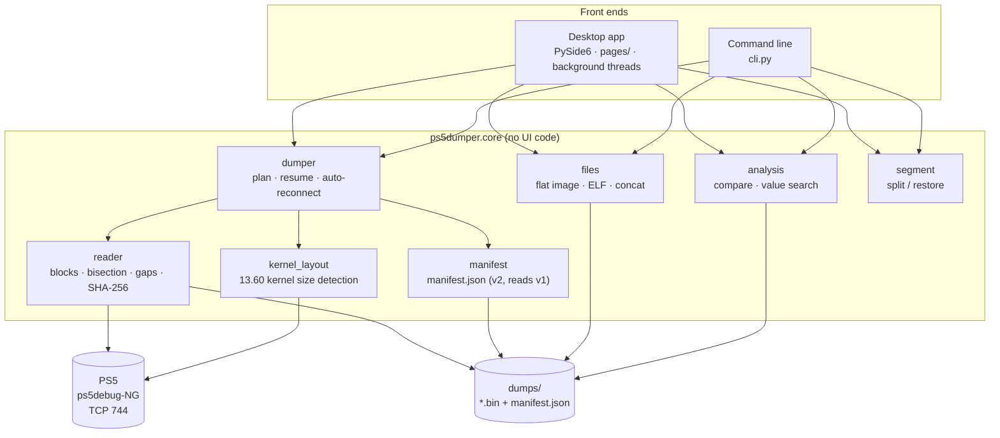

The engine (`ps5dumper.core`) has no user-interface code: it reports progress through a small `Reporter` interface
and stops through a cancel flag. The desktop app runs it on background threads, with one thread that serialises
every request to the console and one for offline work, so the window never freezes.

### Reading memory

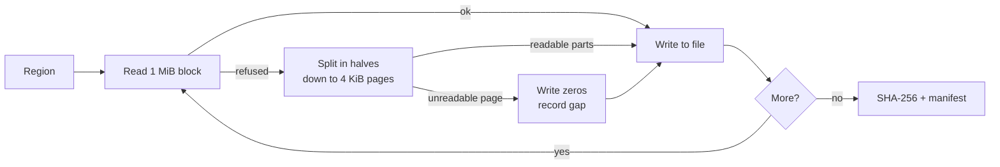

- Reads go in 1 MiB blocks (16 KiB for the kernel). A refused block is bisected until every readable 4 KiB page is
  saved, so one bad page never loses the whole block.
- Unreadable pages are written as zeros (`gap_fill: "zeros"`), keeping **file offset = address − region start**.
  Trailing unreadable bytes are not written. Every gap is listed in the manifest.
- Two consecutive blocks with no readable byte end the region early. After three regions in a row without data,
  the dump switches to an economy mode where a region whose first block is refused is skipped.
- `manifest.json` is rewritten every few seconds, so even an abrupt stop leaves a dump that can be resumed.

### Resume and auto-reconnect

- **Resume** keeps complete regions, continues a partial file from its last byte, reads regions that never
  started, and with *retry gaps* reads gaps again and patches them in place. SHA-256 is recomputed from the
  final files. It refuses when the PID is gone or belongs to another process, or when the kernel `.data` base
  changed (the console restarted), because the addresses would belong to something else.
- **Auto-reconnect** (process dumps): on a dropped connection or protocol error it closes, reconnects and repeats
  the same read, waiting 1, 2, 4… s (at most 30 s). Reads have no side effects, so repeating them is safe. Each
  reconnection is counted in the manifest.

### Kernel capture

- **The hypervisor must be disabled on the PS5 before any kernel dump**: run the hypervisor bypass after the
  jailbreak, then load ps5debug-NG. The PS5 hypervisor protects kernel code, so with it active the code cannot be
  read and a kernel read can restart the console. This applies to the automatic full image, to manual ranges and
  to resuming a kernel dump. The app shows this on the Kernel page, asks you to confirm before each kernel dump,
  and writes it to the activity log; the command line prints it and, in interactive mode, asks you to confirm.
- **Automatic (firmware 13.60)**: from the `.data` base reported by the payload, verified SDK offsets give the
  kernel text base and the `allproc` address. The app then searches 4 KiB boundaries (at most 16 MiB) for the
  kernel's module-info record, as [kdump_ps5](https://github.com/earthonion/kdump_ps5) does. Both identifying
  strings and the reported size must validate; otherwise it stops without guessing. The image is read from the
  text base for exactly the detected size.
- **Manual range**: any start address in the kernel half of the address space and up to 83 MiB.
- **Safeguards**: kernel requests are at most 16 KiB and never cross a 16 KiB boundary. A lost connection stops a
  kernel dump instead of retrying, because a restart changes kernel addresses. PID 0 is always routed to the kernel
  path, never to process-map requests.
- These safeguards do not replace disabling the hypervisor: with the hypervisor bypass active, an invalid or
  protected address can still restart the console. Page recovery for refused kernel blocks is **experimental** and
  off by default.

### Exports

- **Flat image**: the ticked regions written at their offsets from the lowest start address; holes become zeros.
  Checks overlaps, file sizes and SHA-256 first, and refuses images over 4 GiB.
- **ELF**: ELF64, little-endian, x86-64, FreeBSD ABI; `ET_EXEC` by default or `ET_CORE`. One `PT_LOAD` per region:
  `p_vaddr` = region start, `p_filesz` = bytes in the file, `p_memsz` = region size, flags from the region
  permissions, page-aligned file offsets, no section headers. Open it in Ghidra or IDA and every region appears at
  its real address.

### Compare and search

- **Compare** matches regions with the same start and end in both dumps, XORs them in 1 MiB chunks and merges
  changes less than 8 bytes apart into one range (up to 200,000 ranges listed).
- **Search** memory-maps the region files, never matches inside zero-filled gaps, filters aligned addresses for
  numbers by default, and keeps up to 1,000,000 results. *Next scan* reads the same addresses in a later dump and
  keeps those that meet the condition.

## Output format

Each dump is a folder named `<process>_<pid>_<date>_<time>` with one file per region plus a manifest:

```text
dumps/
└── eboot.bin_118_20261028_112540_053773/
    ├── 0000000000400000-0000000001000000.bin
    ├── 0000000200000000-0000000201800000.bin
    └── manifest.json
```

```jsonc
{
  "format_version": 2,
  "tool": "ps5dumper 2.0.0",
  "type": "process",                          // or "kernel"
  "pid": 118, "process": "eboot.bin", "path": "/app0/eboot.bin", "title_id": "PPSA00000",
  "console": "192.168.1.50",
  "started": "2026-10-28T18:25:11+00:00", "finished": "2026-10-28T18:25:17+00:00", "seconds": 5.99,
  "status": "incomplete",                     // complete · incomplete · cancelled · failed
  "bytes": 41930752,
  "gap_fill": "zeros",
  "plan": [ { "name": "executable", "start": "0x400000", "end": "0x1000000", "prot": 5 } ],
  "reconnects": 0,
  "regions": [
    { "name": "executable", "start": "0x400000", "end": "0x1000000", "prot": 5,   // r=1 w=2 x=4
      "file": "0000000000400000-0000000001000000.bin", "bytes": 12570624, "complete": false,
      "gaps": [ { "start": "0x900000", "end": "0x903000", "size": 12288,
                  "type": "BadStatus", "message": "server returned status ERROR" } ],
      "errors": [], "sha256": "…" }
  ]
}
```

<sub>Abridged (one region shown). `plan` lists every region selected, so a resume knows what never started;
`resumed` (timestamps) is added when a dump is resumed. A `status` of `incomplete` means some pages were
unreadable and are listed in `gaps`.</sub>

## Building the .exe

```powershell
powershell -ExecutionPolicy Bypass -File build_exe.ps1
```

The script installs PyInstaller, runs `make_assets.py` (makes the Windows icon from `icone 2.png` and scales
`Icon.png` / `Logo.jpg` into `ps5dumper/gui/assets/`), then builds from `PS5 Memory Dumper.spec`. The result is a
single `dist\PS5 Memory Dumper.exe` of about 28 MB. The spec only bundles DLLs from the Python installation (never
copies found elsewhere on `PATH`), never bundles the Windows C runtime, and leaves out Qt parts the app does not use
(software OpenGL, Qt translations, Qt networking). The `.exe` unpacks itself to a temporary folder on each start
(about a second); some antivirus programs are wary of single-file PyInstaller apps.

## Project layout

```text
ps5dumper/
├── core/            engine, no UI
│   ├── reader.py         block reads, bisection, gaps, SHA-256
│   ├── dumper.py         process/kernel dumps, resume, auto-reconnect
│   ├── kernel_layout.py  kernel size detection (13.60)
│   ├── manifest.py       manifest.json v2, legacy mapas.json
│   ├── console.py        discovery, connection, console info
│   ├── files.py          flat image, ELF export, concatenation
│   ├── analysis.py       compare dumps, value search
│   └── segment.py        split / restore by zero runs
├── gui/             PySide6 app: main_window, worker threads, theme, widgets, pages/, assets/
├── cli.py           command line
└── __main__.py      python -m ps5dumper → app (with arguments → command line)
tests/                     offline regression tests
docs/images/               README graphics
legacy/                    the original single-file script by RamalhoBoss (Portuguese)
PS5 Memory Dumper.pyw      app launcher without a console window
ps5_dumper.py              command-line entry point
segment_memory.py          split / restore entry point
build_exe.ps1, PS5 Memory Dumper.spec, make_assets.py   Windows build
icone 2.png, Icon.png, Logo.jpg                         app icon, sidebar emblem, Connection artwork
```

## Testing and status

```bash
python -m unittest discover -s tests -v
```

The tests cover kernel layout detection and kernel request safeguards offline. During development the app was also
exercised end to end against a simulated console (dumps with holes, cancel and resume, dropped connections,
compare and search) and against real dumps (flat images, ELF export checked with an independent ELF reader).

**Not yet verified on hardware**: the real payload's behaviour on dropped connections, refused kernel pages and
resume timing, and the automatic kernel capture (with the hypervisor disabled), still need a first run on a console.

## Original script

The project started as a single Python script by RamalhoBoss, kept unchanged in
[`legacy/ps5_dumper_original_pt.py`](legacy/ps5_dumper_original_pt.py) (Portuguese). PS5 Memory Dumper is its
evolution and still reads the dumps it made (`mapas.json`).

## Credits and licences

- [ps5dbg](https://github.com/Darkatek7/ps5dbg): Python client for the ps5debug-NG protocol (GPL-3.0).
- [ps5debug-NG](https://github.com/Pharaoh2k/ps5debug-NG): the payload and its SDK, source of the 13.60 kernel offsets.
- [kdump_ps5](https://github.com/earthonion/kdump_ps5): kernel module-info size discovery and request size.
- [Qt for Python (PySide6)](https://doc.qt.io/qtforpython-6/) (LGPL-3.0) and [PyInstaller](https://pyinstaller.org).

PS5 Memory Dumper is © RamalhoBoss and released under the **GNU General Public License v3.0**: see
[LICENSE](LICENSE). The licences of the bundled components are listed in
[THIRD-PARTY-NOTICES.md](THIRD-PARTY-NOTICES.md).

PlayStation and PS5 are trademarks of Sony Interactive Entertainment. This project is not affiliated with or
endorsed by Sony.
